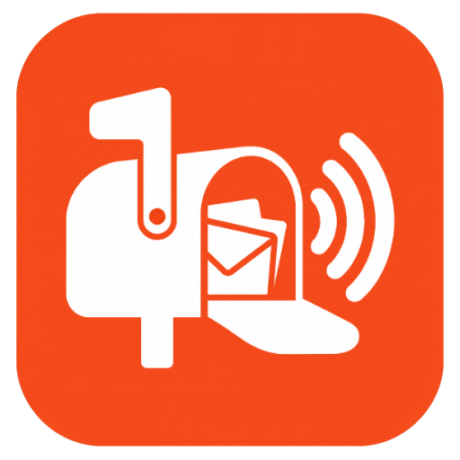
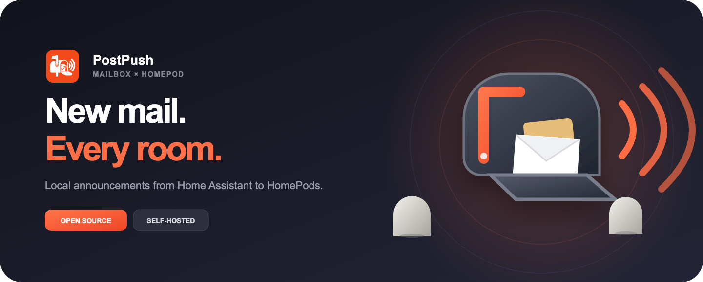
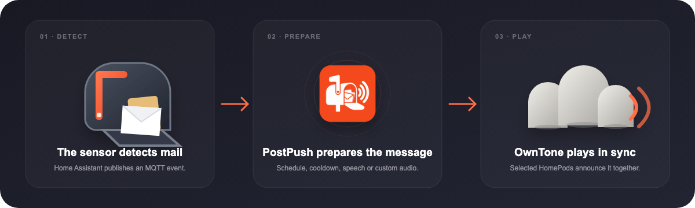
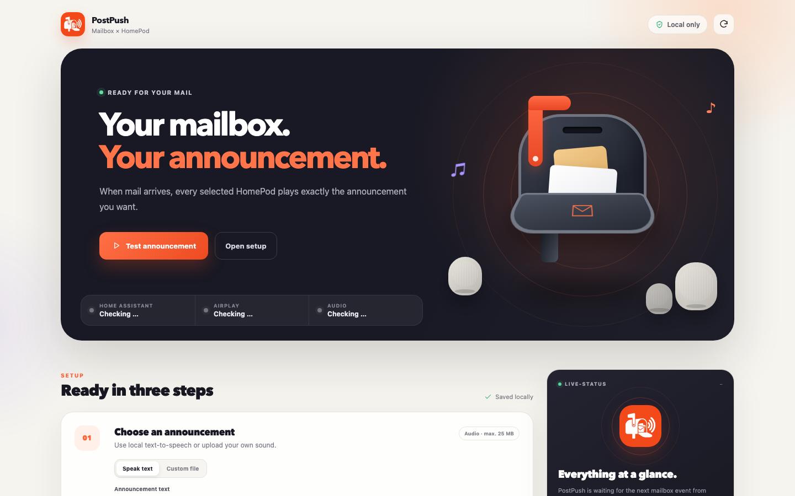

<p align="center">
  
</p>

<p align="center">
  
</p>

<p align="center">
  <a href="https://postpush.klickwerk.digital/"></a>
  <a href="https://github.com/alexholzreiter/postpush/releases"></a>
  <a href="LICENSE"></a>
  <a href="https://buy.stripe.com/00w8wOcsV8WHdr7apqaZi04"></a>
</p>

# PostPush

PostPush is a self-hosted mailbox announcement bridge for HomePods:

```text
Mailbox sensor → Home Assistant → MQTT → PostPush → HomePods
```

It can speak any configured message locally with Piper or play an uploaded
audio file. OwnTone handles synchronized playback on all or selected HomePods
and AirPlay speakers. The browser interface controls the announcement source,
speaker selection, active hours, volume, cooldown, and master switch.

**Website:** [postpush.klickwerk.digital](https://postpush.klickwerk.digital/)

**Install:** [Runtipi](#install-on-runtipi) · [Docker Compose](#run-with-docker-compose)

## How it works

<p align="center">
  
</p>

Home Assistant publishes a non-retained MQTT event when the mailbox sensor
detects mail. PostPush checks its master switch, schedule, and cooldown before
preparing either local speech or the uploaded sound. OwnTone then sends the
announcement to the configured AirPlay outputs.

## Web interface

<p align="center">
  
</p>

The interface provides:

- local Piper text-to-speech with a configurable announcement
- custom MP3, WAV, M4A, AAC, FLAC, or OGG uploads up to 25 MB
- individual HomePod and AirPlay speaker selection
- volume, active hours, and duplicate-event cooldown
- live MQTT, OwnTone, audio, and last-event status
- a direct test action without waiting for a real mailbox event

All application settings and audio files remain on the local server.

## Requirements

- Home Assistant with a working mailbox sensor
- an MQTT broker reachable by Home Assistant and PostPush
- a Runtipi or Docker host on the same local network/VLAN as the HomePods
- Apple Home: **Home Settings → Speakers & TV → Anyone On the Same Network**

On Runtipi, [Ring HomePod Doorbell](https://github.com/alexholzreiter/ring-homepod-doorbell)
must be installed on the same host first, because PostPush plays through its
OwnTone service. See [Why Ring HomePod Doorbell is required](#why-ring-homepod-doorbell-is-required).
The standalone Docker Compose setup brings its own OwnTone and does not need it.

## Reference hardware

PostPush works with any sensor that Home Assistant can turn into an MQTT event.
This is the setup it is developed and tested with:

| Part | Model | Role |
|---|---|---|
| Mailbox sensor | HOBEIAN ZG-204ZL (Zigbee PIR motion and light sensor, battery powered) | Mounted inside the mailbox; detects the flap or a letter dropping in |
| Zigbee coordinator | SONOFF Zigbee 3.0 USB Dongle Plus (Z-Stack) | Connects the sensor to Zigbee2MQTT |
| Zigbee bridge | Zigbee2MQTT 2.14 on a Raspberry Pi | Publishes the sensor state to MQTT |
| MQTT broker | Eclipse Mosquitto | Shared by Zigbee2MQTT, Home Assistant, and PostPush |
| Automation | Home Assistant | Sends the PostPush MQTT event when the sensor turns on |
| Server | x86-64 Linux host with Runtipi | Runs PostPush and OwnTone |
| Speakers | Apple HomePods (HomePod OS 27) | Play the announcement over AirPlay 2 |

The reference sensor runs with `sensitivity: high` and `keep_time: 30` in
Zigbee2MQTT. Its occupancy entity
(`binary_sensor.<device>_occupancy`) is the trigger in the Home Assistant
automation below.

## Install on Runtipi

1. **Install Ring HomePod Doorbell first.** In Runtipi, open
   **Settings → App Stores** and add its store under the name **`doorbell`**:

   ```text
   https://github.com/alexholzreiter/ring-homepod-doorbell
   ```

   Install the app and check that it finds your HomePods. The store name
   matters: PostPush expects the DoorBell data under
   `app-data/doorbell/ring-homepod-doorbell`.

2. **Add the PostPush store** in the same place:

   ```text
   https://github.com/alexholzreiter/postpush
   ```

3. **Install PostPush** and enter the MQTT broker URL, username, password, and
   topic. A dedicated MQTT account named `postpush` with read access to
   `postpush/events/mail` is recommended.

4. Open `http://YOUR-SERVER-IP:8586`, select the HomePods, and press
   **Test announcement**.

PostPush uses port `8586` for its web interface. The app is intentionally not
exposable through Runtipi and should remain available only on the trusted home
network.

### Why Ring HomePod Doorbell is required

HomePods on HomePod OS 27 need AirPlay 2 timing over the fixed PTP ports `319`
and `320`. Only one OwnTone instance per host can hold these ports, so two apps
that each start their own OwnTone cannot run side by side. The Runtipi package
therefore does not start its own OwnTone and shares the DoorBell's instance:

| Shared resource | Where |
|---|---|
| OwnTone API | `http://127.0.0.1:3689` |
| Audio files | `app-data/doorbell/ring-homepod-doorbell/data/media`, mounted as `/data/media` |

What this means in practice:

- **Uninstalling, stopping, or reinstalling the DoorBell app stops PostPush
  announcements.** Restarting or updating it interrupts them briefly.
- PostPush stores its generated speech and uploaded sounds in the DoorBell's
  media folder (files starting with `postpush-`). After a fresh DoorBell
  install, upload a custom sound again; speech is regenerated automatically.
- A mailbox announcement and a doorbell chime use the same player. If both are
  triggered at the same moment, the later one replaces the earlier one.
- Do not install another OwnTone app on the same host.

## Connect Home Assistant

Keep any existing phone-push automation unchanged and add a separate MQTT
automation for PostPush:

```yaml
alias: "Mailbox: PostPush"
triggers:
  - trigger: state
    entity_id: binary_sensor.0xa4c138dd803d5113_occupancy
    from: "off"
    to: "on"
actions:
  - action: mqtt.publish
    data:
      topic: postpush/events/mail
      payload: '{"event":"mail","source":"home_assistant"}'
      retain: false
mode: single
```

Replace the entity ID with the mailbox sensor used in your Home Assistant
installation. `retain` must remain `false`; otherwise an old mailbox event
could be replayed after a service restart.

The configured topic accepts any of these non-retained payloads:

```json
{"event":"mail"}
```

Plain `mail`, `on`, `true`, `1`, and `{"post":true}` are accepted as well.

## Run with Docker Compose

```bash
cp .env.example .env
nano .env
docker compose up -d --build
docker compose logs -f
```

Open `http://YOUR-SERVER-IP:8586`, choose the announcement, select the
speakers, and press **Test announcement**.

The standalone stack uses:

- port `8586` for the PostPush web interface
- port `3690` for its dedicated OwnTone instance
- `data/` for persistent settings, generated speech, uploads, and OwnTone state

## Troubleshooting

| Symptom | Check |
|---|---|
| The web interface says "Announcement played", but nothing is audible | HomePods buffer several seconds before they play. PostPush adds 1.5 s of silence before and 5 s after every announcement; increase `PLAYBACK_LEAD_IN_MS` or `PLAYBACK_TAIL_MS` if the start or end is still cut off. |
| Test works, but the mailbox does not trigger anything | **Last MQTT message** stays empty: the Home Assistant automation does not publish to the PostPush topic. A phone-notification automation alone does not send MQTT; add the automation from [Connect Home Assistant](#connect-home-assistant) and check its traces. |
| "The selected audio file could not be found." | The DoorBell app was reinstalled and its media folder is new. Upload the custom sound again. |
| No HomePods listed | Apple Home → Home Settings → Speakers & TV → **Anyone On the Same Network**, and the DoorBell app must be running. |
| OwnTone unavailable | Check that the DoorBell's `owntone` container is running. |

## Privacy and behavior

- Piper generates speech locally; announcement text is not sent to cloud TTS.
- The web application has no external fonts, trackers, analytics, or CDNs.
- MQTT event messages are processed locally and are not retained by PostPush.
- An AirPlay announcement can briefly interrupt music already playing.
- mDNS and the dynamic AirPlay ports must be routed when using separate VLANs.

## Support

PostPush is free and open source. If it makes the mailbox a little smarter and
you would like to support continued development, you can tip a coffee through
Stripe:

[](https://buy.stripe.com/00w8wOcsV8WHdr7apqaZi04)

## Development

```bash
npm install
npm test
docker compose config
docker build -t postpush:test .
```

Status endpoints:

- `GET /api/status`
- `GET /health`

The static, tracking-free project website lives in [`website/`](website/) and
is automatically deployed to GitHub Pages after changes reach `main`.

## License

PostPush is open-source software licensed under the [MIT License](LICENSE).
Copyright © 2026 Alexander Holzreiter.

Piper itself is distributed under GPL-3.0. The included Thorsten voice model
has its own license and is downloaded during the container build.
